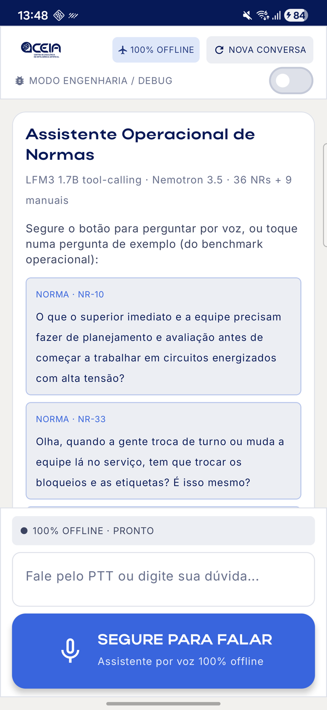
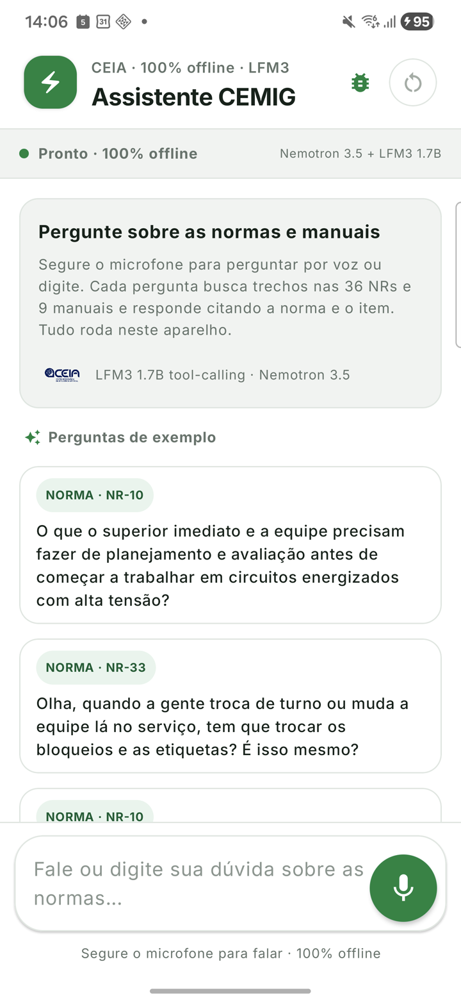
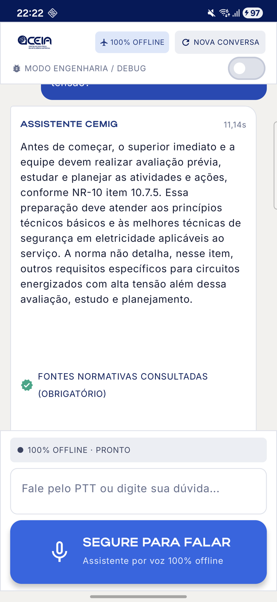
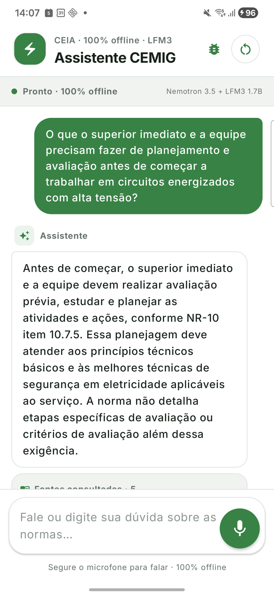

# F8 — evolução da UI: aproximar do app "Assistente CEMIG" sem perder função

**Entrega**: APK release (default LFM3 Q4_0 + Nemotron, motor **intocado**) com a UI nova, instalado e
validado no Galaxy S24+ (`192.168.0.15:34733`). Mudança **só de UI** (`android/app/.../ui/**`); nenhum
arquivo de `domain/`, `data/` ou nativo foi alterado.

## 1. Estudo do alvo — `github.com/vinyteles/cemig-mobile` (main @ `2b02a5c`)

App **Expo / React Native** (TypeScript + NativeWind/Tailwind, ícones lucide), não Compose/XML →
não há layout/drawable Android reaproveitável; tudo teria de ser **recriado** em Compose de qualquer forma.

| Elemento | No app deles | Arquivo |
|---|---|---|
| Telas | chat (`index`), setup/download de assets, backends, bench | `src/app/*.tsx` |
| Cabeçalho | selo verde arredondado com raio (Zap) + "EnergyGPT mobile · MobileRAG+" / **"Assistente CEMIG"** + botões-ícone (backends, arquivos, reiniciar sessão c/ confirmação) | `index.tsx::Header` |
| Monitor | faixa "Monitor do dispositivo" (anéis RAM/CPU) sob o cabeçalho | `resource-monitor.tsx` |
| Chat | bolha do usuário verde à direita (`rounded-3xl rounded-tr-lg`); assistente à esquerda com rótulo "✦ Assistente" + bolha branca com borda | `MessageBubble` |
| Fontes | cartão muted "📖 Fontes" com linhas compactas + linha de tempos clicável (`total · 1º token · tok/s`) que abre painel por etapa | `AnswerFooter` |
| Busca | bolha violeta **"Pensando"** com spinner "Buscando trechos nos documentos" | `StatusBubble` |
| Erro | banner vermelho claro com ícone de alerta | `ErrorBanner` |
| Composer | cartão `rounded-3xl` com campo multilinha + botão circular de enviar (spinner quando ocupado) — **sem voz** | `Composer` |
| Splash | overlay `#208AEF` com logo Expo + fade | `animated-icon.tsx` |
| Tema | `--color-primary #00843d` (verde CEMIG), background `#f4f7f5`, foreground `#15221b`, muted `#f0f3f1`/`#66736c`, border `#dfe6e1`, destructive `#c93636` | `src/global.css` |
| Logo/assets | **só os placeholders do template Expo** (`expo-logo.png`, ícones `android-icon-*`); não há logo CEMIG/CEIA | `assets/images/` |

### Licença e decisão (importado × recriado)
- `LICENSE` do repo = **MIT "Copyright 650 Industries (Expo)"** — é a licença do *template* Expo, não uma
  licença emitida pelo autor do app. Por isso **nenhum arquivo foi copiado**: importamos **ideias e
  valores de design** (layout, hierarquia, tokens de cor) e **recriamos** tudo em Compose.
- **Logo**: o repo deles não tem logo próprio (só o logo do Expo, marca de terceiro) → **mantido o logo
  CEIA** (no cartão de boas-vindas) e o selo do cabeçalho é um **raio recriado** com ícone Material
  (`ElectricBolt`), como o selo `Zap` deles.
- **Paleta**: a deles (verde CEMIG `#00843d`) é diferente da nossa (marinho/azul/teal da F7). Pelo
  brief ("na dúvida, siga a DELES"), o tema passou a ser o verde deles (`ui/theme/Color.kt` bloco
  `Cemig*`, valores do `global.css`). Os tokens `Ceia*` continuam no arquivo (usados pelo card de
  telemetria do Modo Engenharia).

| | Importado (ideia/valor) | Recriado em Compose |
|---|---|---|
| Paleta (`global.css`) | ✅ valores hex | `Color.kt` / `Theme.kt` |
| Cabeçalho, bolhas, "Pensando", fontes, rodapé de tempos, composer, erro | ✅ layout | `MainScreen.kt`, `SourcesSection.kt`, `PushToTalkButton.kt` |
| Diálogo "Reiniciar sessão?" | ✅ texto/fluxo | `AlertDialog` |
| Splash animado | ✅ ideia | `SplashOverlay` (verde CEMIG + selo, 0,9 s + fade) |
| Monitor de recursos | ❌ não trazido (exige módulo nativo novo; fora do escopo UI-only) | no lugar: **faixa de status do pipeline** (mesmo slot visual) |
| Logo | ❌ (só existe logo Expo) | logo CEIA mantido |

## 2. Adaptações (funcionalidade nunca sacrificada)
| Conflito | Escolha |
|---|---|
| App deles **não tem voz** | botão circular do composer é **contextual**: microfone **segurar-para-falar** (56 dp, luvas) quando vazio, seta **enviar** quando há texto, spinner com pipeline ocupado; gravando = vermelho pulsante + borda vermelha + dica "Gravando… solte para transcrever"; depois "Revise a transcrição e toque em enviar" (fluxo anti-reprocessamento do ASR preservado: Final não auto-envia) |
| **Sem slot para chips** de exemplo | chips entram no **estado vazio**, abaixo do cartão explicativo ("✦ Perguntas de exemplo"), com selo NORMA (verde) / MANUAL (âmbar) |
| Fontes deles são 1 linha sem conteúdo | mantida a **expansão por trecho** (texto integral + score/página), agora com índice `[n]`, selo da norma, "item X.Y" e selo **MANUAL NR-xx** em âmbar |
| Busca: deles só "searching" | bolha "Pensando" com rótulo do estado real do tool-calling: *decidindo* → **buscando trechos** (modelo chamou `buscar_norma`) → *lendo trechos*/*respondendo com o contexto da conversa* (reuso). Faixa de status também mostra a etapa |
| Streaming | fontes **em cima**, texto crescendo **abaixo** com auto-scroll (ajuste de UI 1 do capitão preservado) |
| Modo Engenharia | botão-ícone no cabeçalho (preenchido quando ativo) + selo "MODO ENGENHARIA" na faixa; `DebugTurnCard` inalterado sob cada resposta |
| Nova conversa | botão outline com **confirmação** (padrão deles); limpa histórico e KV cache como antes |

Correções de UI encontradas no caminho: (a) a **Inter variável não tinha `variationSettings`** → todo
peso saía Regular (bug preexistente; agora negrito real); (b) `AlertDialog` herdava `extraLarge=999dp`
do tema (forma oval) → canto fixo 24 dp; (c) botão com alpha + sombra gerava artefato poligonal → cor
sólida desabilitada; (d) limpar o campo agora encerra o estado "revisar transcrição".

## 3. Checklist de regressão (S24+, release, 05/11/2026)
| Função | Status | Evidência |
|---|---|---|
| Voz Nemotron — segurar mic / gravar / transcrever / revisar / enviar | ✅ | `depois_07_voz_gravando`, `depois_09_voz_revisar` (gravação 5,8 s pela UI, transcrição Nemotron via logcat). Áudio pelo alto-falante não chega limpo ao mic (o texto saiu "A partir de então…") — a **qualidade** de voz foi medida pelo runner F7 `--ez voice true`: **8/8 transcritas e respondidas**, ASR 1,3–3,0 s, top-5 idêntico ao da F7 (`data/f7_runner_voice_results.json`) |
| Limpar transcrição → volta a microfone | ✅ | `depois_10_limpar_volta_mic` |
| Digitar + enviar | ✅ | `depois_11_digitado_enviar` |
| Chips de perguntas-exemplo (8, norma/manual) | ✅ | `depois_02_inicial_chips`; tocados no E2E abaixo |
| Indicação de busca (tool-calling) | ✅ | `depois_03_pensando_decidindo` → `depois_04_buscando` ("Buscando trechos nas normas e manuais" após `ToolDecided buscar=true`) |
| Streaming (fontes em cima, texto abaixo) | ✅ | `depois_05_streaming` |
| Citação de fonte (NR + item, expansível) | ✅ | `depois_06_resposta_fontes`, `depois_13_fonte_expandida` (NR-10 Anexo II c/ texto), selo MANUAL em `e2e_08_fontes` |
| Tempos por etapa | ✅ | `depois_14_tempos_debug` (voz/decisão/busca/1º token/geração/tokens/total) |
| Modo Engenharia | ✅ | `depois_12_resposta_debug`, `depois_14_tempos_debug` (telemetria inalterada) |
| Multiturno | ✅ | `depois_15_multiturno` (follow-up "E isso vale também para 34,5 kV?") |
| Nova conversa (com confirmação) | ✅ | `depois_16_nova_conversa_confirmar` |
| Carregamento dos modelos / splash | ✅ | `depois_00_splash`, `depois_01_carregando` |
| Config op por baixo (LFM3 Q4_0 + Nemotron + ponto op F6) | ✅ inalterado | 0 arquivos fora de `ui/`; `./gradlew test` verde (inclui `F7ParityTest`, `AsrEventContractTest`); PSS 3,76 GB (F7: 3,7–3,8) |

## 4. 8 perguntas-exemplo fim-a-fim **pela UI** (`ui_e2e.py`, toque real no chip)
`data/ui_e2e_results.json`; screenshots `e2e_NN.png` (resposta) e `e2e_NN_fontes.png` (fontes).

| # | Esperado | Buscou | Fonte esperada na tela | Total (UI) | Resposta (início) |
|---|---|---|---|---|---|
| 1 | NR-10 | ✅ | ✅ NR-10 item 10.7 | 10,6 s | "…realizar avaliação prévia, estudar e planejar as atividades…" |
| 2 | NR-33 | ✅ | ✅ NR-33 item 33.5.14 | 9,4 s | "Sim, pela NR-33, item 33.5.14.2, alínea d…" |
| 3 | NR-10 | ✅ | ✅ NR-10 item 10.2 | 9,4 s | "…carga instalada superior a 75 kW" |
| 4 | NR-18 | ✅ | ✅ NR-18 item 18.8.6 | 10,7 s | "…altura superior a 2 m, conforme NR-22 item 22.10.2" |
| 5 | NR-34 | ✅ | ✅ NR-34 item 34.5.5 | 10,0 s | "…fechar as válvulas dos cilindros, dos maçaricos e dos distribuidores" |
| 6 | NR-10 · Manual | ✅ | ✅ MANUAL NR-10 | 8,9 s | "…no local do serviço… superior e trabalhador/equipe" |
| 7 | NR-10 · Manual | ✅ | ✅ MANUAL NR-10 | 12,6 s | "…NR-10 item 10.8.7… condições efetivas… natureza do trabalho" |
| 8 | NR-33 · Guia | ✅ | ✅ MANUAL NR-33 | 10,8 s | "…vara de extensão… boia na sonda…" |

**8/8 respondidas, 8/8 com cartão de fontes e a fonte esperada visível**; 1º token 3,1–3,9 s, ~24,5 tok/s
(F7: total ~12 s). Não houve rejulgamento 27B: as respostas vêm do mesmo motor/contexto da F7 (8/8 aprovadas);
esta fase mede a UI.

## 5. Antes × depois
| Antes (F7) | Depois (F8) |
|---|---|
|  |  |
|  |  |

## Reprodução
```bash
cd android && ./gradlew test assembleRelease && ./gradlew --stop   # default LFM3 Q4_0 + Nemotron
bench/lfm3_f7/device/deploy_and_measure.sh <serial>                 # instala + pesos externos
python3 bench/lfm3_f8/ui_e2e.py <serial>                            # 8 chips pela UI (adb+uiautomator)
adb -s <serial> shell am broadcast -a br.org.ceia.cemigpoc.RUN_F7_E2E -p br.org.ceia.cemigpoc --ez voice true
```

## APK publicado no HF (pedido final do capitão)
- `https://huggingface.co/juniorrios/automobil-ultra-semnexo/blob/main/apk/cemig-assistente-v1.0.0-f8.apk`
  (commit HF `d35d8a9`; card com seção "APK Android" no commit `aff14d9`, espelhado em `release/README.md`).
- Identidade conferida: SHA-256 `91aaf20a…3a77c7` = build local = `base.apk` puxado do S24+ (`adb shell pm path`)
  = arquivo baixado de volta do HF; 235.986.717 bytes.
- O APK **não embute os pesos** (LFM3 GGUF 1,05 GB, EmbeddingGemma 265 MB, Nemotron 651 MB): o card traz o
  sideload com as 3 fontes públicas, cada uma verificada por SHA-256 contra os arquivos do aparelho validado.
